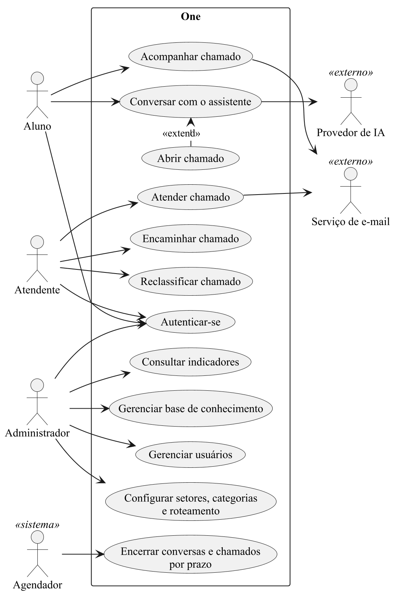
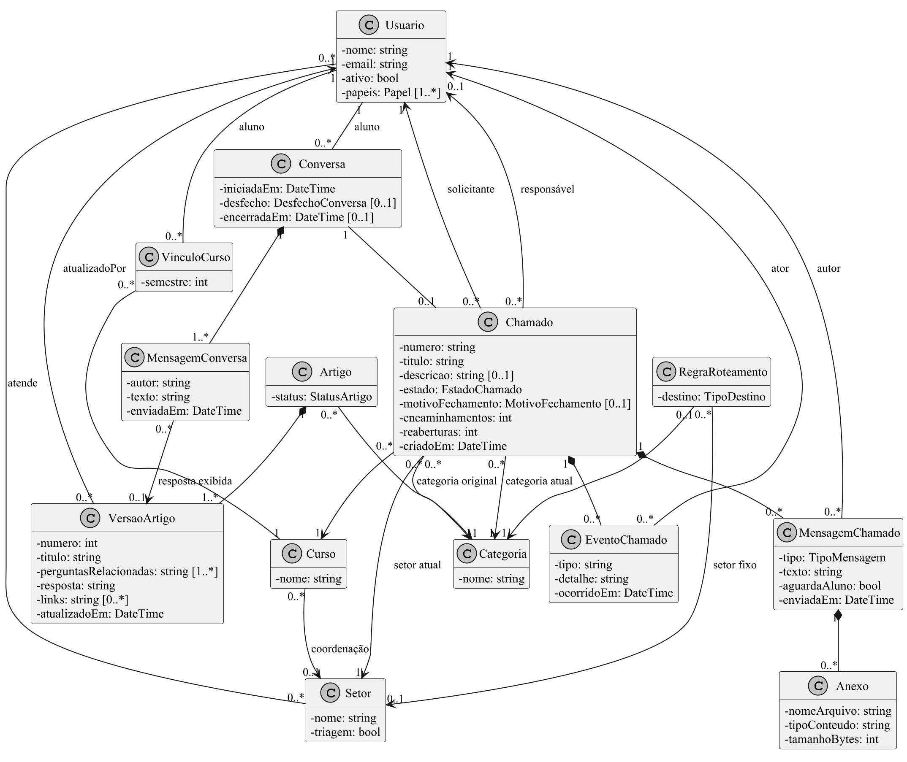
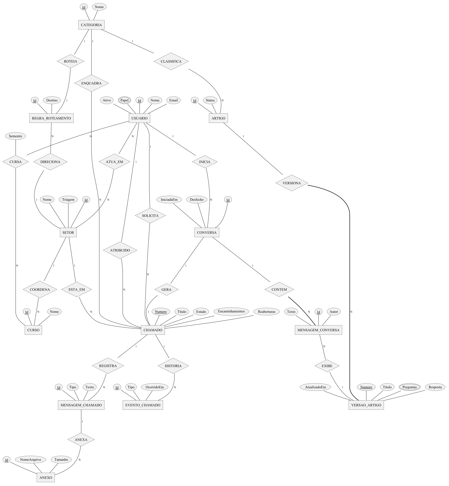
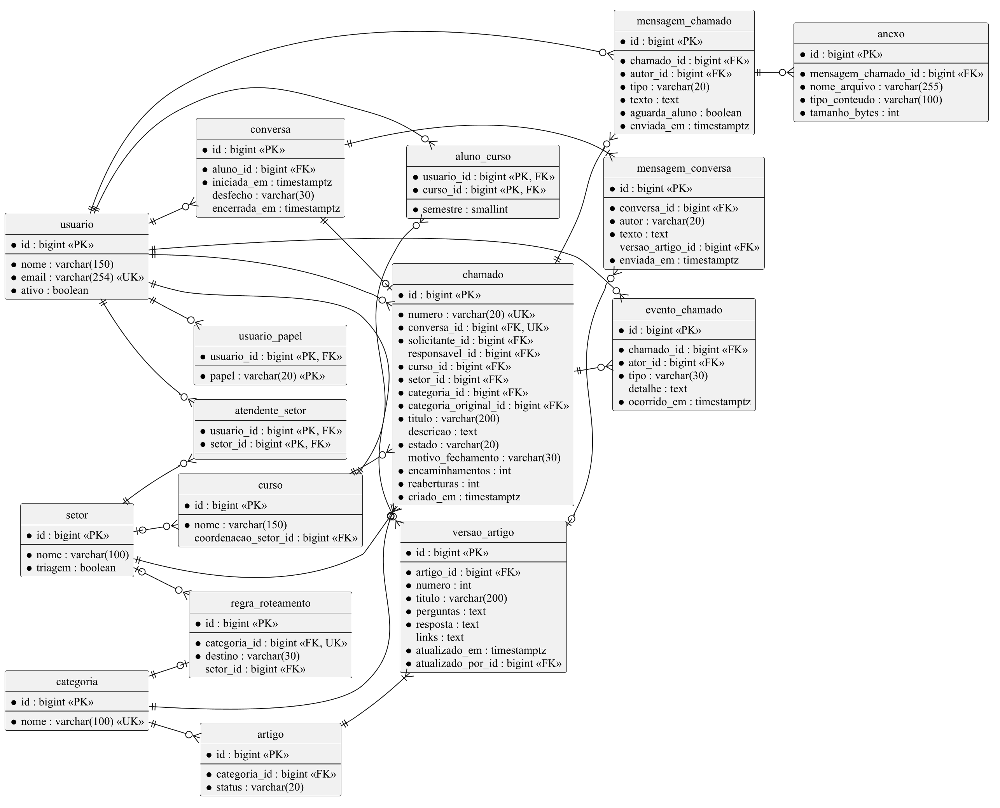

Este documento apresenta o levantamento e a especificação dos requisitos do One, aplicação web progressiva de atendimento acadêmico desenvolvida no Projeto Extensionista Integrador IV do Curso Superior de Tecnologia em Análise e Desenvolvimento de Sistemas do UNIVAG. O problema tratado é o atendimento aos alunos disperso entre WhatsApp, e-mail e ambiente virtual de aprendizagem, sem registro das conversas, sem triagem das demandas e sem dados sobre o que os alunos mais perguntam. O levantamento combinou duas sessões de entrevista com a coordenadora dos cursos de tecnologia, uma pesquisa de mercado sobre plataformas de atendimento e a análise documental do manual da disciplina. Nos sete dias anteriores à segunda entrevista, a coordenação recebeu cerca de 256 mensagens de alunos, das quais metade eram demandas de fato. A partir desses dados, o documento define o escopo do produto mínimo viável, os requisitos funcionais rastreados às regras de negócio do projeto, os requisitos não funcionais, os casos de uso com suas especificações, o diagrama de classes e os modelos conceitual e lógico de dados. O fluxo central é: o aluno pergunta, o assistente tenta resolver a dúvida com base em artigos publicados pela instituição e, quando não resolve, a conversa se torna um chamado rastreável, encaminhado ao setor responsável sem que o aluno precise repetir o pedido. As questões ainda em aberto com a coordenação são tratadas como premissas a confirmar.

Palavras-chave: atendimento acadêmico; levantamento de requisitos; aplicação web progressiva; base de conhecimento; rastreabilidade.

# Introdução

O atendimento acadêmico de uma instituição de ensino superior envolve dúvidas e pedidos que chegam por muitos canais e são resolvidos por pessoas diferentes: coordenação, professores, secretaria e a Central de Atendimento ao Estudante. Quando esses pedidos chegam por mensagens informais, a instituição não sabe quem recebeu cada pedido, quem está cuidando dele, quanto tempo levou nem se foi resolvido. O aluno, por sua vez, não sabe a quem recorrer e precisa repetir a história a cada redirecionamento.

O One é a proposta do grupo para esse problema: um único ponto de contato em que o aluno descreve o que precisa em linguagem natural, recebe uma resposta imediata quando ela já existe e, quando não existe, tem o pedido registrado e direcionado ao setor certo. A ideia que orienta o produto é que o aluno não precisa saber quem resolve; o sistema precisa.

## Propósito do documento

Este documento registra como os requisitos do One foram levantados e especifica o que o produto mínimo viável deve fazer. Ele corresponde à entrega de elicitação de requisitos do produto prevista para o Projeto Extensionista Integrador IV (UNIVAG, 2026) e serve de base para o protótipo, para a implementação e para a avaliação do piloto.

Os leitores previstos são o professor orientador, que avalia a entrega; os integrantes do grupo, que implementam o sistema; e a coordenação dos cursos de tecnologia, que valida as premissas adotadas.

## Escopo do produto

O produto mínimo viável cobre um único fluxo, do início ao fim: perguntar, tentar resolver, registrar, direcionar, atender, resolver e medir. Para isso, ele reúne oito módulos: identidade e acesso; base de conhecimento; assistente que responde somente a partir da base; conversão da conversa em chamado; roteamento por categoria; ciclo de vida e atendimento do chamado; histórico auditável; e indicadores.

O piloto previsto envolve uma instituição (Univag), uma coordenação (cursos de tecnologia), os alunos de Análise e Desenvolvimento de Sistemas, até três setores e de dez a trinta artigos na base de conhecimento.

Ficam fora do escopo do produto mínimo viável:

- aplicativo nativo, atendimento pelo WhatsApp, notificações push e chat em tempo real;
- integrações com Moodle, sistema acadêmico, Portal do Aluno ou sistema financeiro;
- prioridade de chamados e acordos de nível de serviço;
- roteamento por inteligência artificial e detecção automática de incidentes coletivos;
- criação automática de artigos a partir de chamados resolvidos;
- artigos diferentes por curso ou perfil, uso por várias instituições, exportação de relatórios e pesquisa de satisfação.

## Premissas do projeto

Parte das decisões depende de respostas da coordenação que ainda não foram dadas. Para cumprir o calendário da disciplina, o grupo adotou uma premissa para cada questão em aberto, apresentada no Quadro 1. Cada premissa será substituída pela resposta da coordenação assim que ela for obtida.

Quadro: Premissas adotadas para as questões em aberto
| Questão | Tema | Premissa adotada | Situação |
|---|---|---|---|
| Q5 | Autenticação | Contas locais criadas pelo administrador, individualmente ou por importação em lote; sem login institucional no piloto | a confirmar com a coordenação |
| Q6 | Inatividade da conversa | A conversa sem resposta do aluno por 30 minutos é encerrada como abandonada | a confirmar com a coordenação |
| Q7 | Prazo de confirmação | O aluno tem 7 dias corridos para confirmar ou rejeitar a resolução; depois disso o chamado é fechado automaticamente | a confirmar com a coordenação |
| Q8 | Troca de responsável | Qualquer atendente do setor pode assumir um chamado atribuído a um colega, com registro no histórico | a confirmar com a coordenação |
| Q9 | Anexos | Permitidos nas respostas públicas: PDF, JPG e PNG, até 10 MB cada | a confirmar com a coordenação |
| Q10 | Tempo nos indicadores | Tempos medidos em tempo corrido, sem descontar horário fora do expediente | a confirmar com a coordenação |
| Q11 | Coordenação como setor | A coordenação de cada curso é um setor comum, e a coordenadora é atendente desse setor | a confirmar com a coordenação |
| Q12 | Acesso ao painel | O painel de indicadores é visto apenas pelo administrador | a confirmar com a coordenação |
| Q13 | Uso de IA externa | As mensagens dos alunos podem ser processadas por um provedor externo de IA, com aviso visível; anexos nunca são enviados | a confirmar com a coordenação |
| Q14 | Representantes de turma | Não são modelados no produto mínimo viável | a confirmar com a coordenação |
| Q15 | Exigência do MEC | O histórico é mantido sem exclusão; o prazo de retenção e o formato exigido pelo MEC estão pendentes | a confirmar com a coordenação |
| Q16 | Funil de demandas | As categorias iniciais vêm do Quadro 6; o volume de cada tipo está pendente | a confirmar com a coordenação |
| Q17 | Linha de base | Os valores do Quadro 5 são a referência para comparar o piloto; alguns pontos estão pendentes | a confirmar com a coordenação |
| Q18 | Demandas do professor | Não são roteadas ao professor; um artigo orienta o aluno a procurá-lo diretamente | a confirmar com a coordenação |
| Q19 | Dados do aluno | O cadastro do aluno inclui curso e semestre, carregados na importação | a confirmar com a coordenação |
Fonte: elaborado pelos autores (2026).

## Convenções, termos e abreviações

Os requisitos funcionais são identificados por RF-NN, os não funcionais por RNF-NN e os casos de uso por UC-NN. Cada requisito funcional indica, na coluna Origem, as regras da especificação de negócio do projeto de que deriva: regras BR (por exemplo, BR-A1) e transições de estado do chamado F1 a F9. Os termos usados no documento estão no Quadro 2 e as abreviações no Quadro 3.

Quadro: Termos do domínio
| Termo | Significado |
|---|---|
| Aluno | Usuário final que faz perguntas e é dono dos seus chamados |
| Atendente | Funcionário que atende os chamados dos setores a que pertence |
| Administrador | Usuário que configura usuários, setores, categorias, roteamento e base de conhecimento |
| Setor | Unidade da instituição que possui uma fila de chamados, como uma coordenação de curso ou a CAE |
| Setor de triagem | O único setor que recebe os chamados não cobertos por nenhuma regra de roteamento |
| Conversa | Troca entre o aluno e o assistente, da primeira mensagem até o desfecho |
| Artigo | Item da base de conhecimento usado pelo assistente para responder |
| Chamado | Pedido rastreável criado a partir de uma conversa não resolvida; para o aluno, aparece como solicitação |
| Resposta pública | Mensagem do chamado visível ao aluno |
| Nota interna | Mensagem do chamado visível apenas a atendentes e administradores |
| Encaminhar | Mover o chamado para a fila de outro setor |
Fonte: elaborado pelos autores (2026).

Quadro: Abreviações
| Sigla | Significado |
|---|---|
| ADS | Análise e Desenvolvimento de Sistemas |
| API | Interface de programação de aplicações |
| AVA | Ambiente virtual de aprendizagem |
| CAE | Central de Atendimento ao Estudante |
| IA | Inteligência artificial |
| LGPD | Lei Geral de Proteção de Dados Pessoais |
| MEC | Ministério da Educação |
| PEI | Projeto Extensionista Integrador |
| PWA | Aplicação web progressiva (progressive web app) |
| REST | Estilo de arquitetura para serviços web baseado em recursos e no protocolo HTTP |
| RF | Requisito funcional |
| RNF | Requisito não funcional |
| SPA | Aplicação de página única (single page application) |
| UC | Caso de uso |
Fonte: elaborado pelos autores (2026).

## Estrutura do documento

A seção 2 descreve as técnicas de levantamento e o que elas revelaram. A seção 3 apresenta a visão geral do produto, seus usuários e as soluções similares. A seção 4 especifica os requisitos funcionais e não funcionais. A seção 5 documenta as funcionalidades com o diagrama de casos de uso, as especificações dos casos de uso, o diagrama de classes e os modelos conceitual e lógico de dados. A seção 6 traz as considerações finais, as questões em aberto e os próximos passos.

# Levantamento de requisitos

## Técnicas utilizadas

O levantamento usou três técnicas, resumidas no Quadro 4. A principal foi a entrevista com a coordenadora dos cursos de tecnologia do Univag, realizada em duas sessões. O roteiro da segunda sessão perguntava sobre fatos passados, como a quantidade de mensagens recebidas na última semana, e não sobre intenções, para evitar respostas hipotéticas. Os números citados pela equipe antes da entrevista foram tratados como estimativa e substituídos pelos valores informados por ela.

Quadro: Técnicas de levantamento utilizadas
| Técnica | Fonte | Data | Resultado principal |
|---|---|---|---|
| Entrevista semiestruturada, em duas sessões | Coordenadora dos cursos de tecnologia | Setembro de 2026 e 1º de outubro de 2026 | Problema, linha de base de volume e tempo, lista de demandas e de quem as resolve |
| Pesquisa de mercado | Sites de fornecedores, estudos independentes e casos publicados | Setembro de 2026 | Soluções similares, padrões de atendimento e modos de falha conhecidos |
| Análise documental | Manual do PEI e instrumento de avaliação institucional do INEP | Setembro e outubro de 2026 | Estrutura de entrega, restrições técnicas e a exigência de registro dos atendimentos |
Fonte: elaborado pelos autores (2026).

## Situação atual

A comunicação entre alunos e coordenação está dispersa em vários canais. O canal oficial, que era o WhatsApp, passou a ser o e-mail. Não existe registro das conversas e das respostas, e a coordenadora relatou que manter esse registro é uma exigência do MEC para a instituição; o instrumento de avaliação institucional pede canais de comunicação com a comunidade e que as manifestações gerem insumos para melhoria (BRASIL, 2017), mas o indicador exato e o prazo de retenção ainda precisam ser confirmados.

A coordenadora divide cerca de 40 horas semanais entre aulas, coordenação de cursos e gestão de professores, o que deixa pouco tempo para as demandas dos alunos. Os representantes de turma foram criados como um filtro, para que só os assuntos importantes cheguem a ela. As demandas mais citadas na primeira sessão, o boleto do semestre e o atestado de escolaridade, já podem ser resolvidas pelo próprio aluno no Portal do Aluno; o problema, portanto, não é a falta do serviço, mas saber onde ele está.

## Volume e tempo de atendimento

O Quadro 5 reúne a linha de base informada pela coordenadora na segunda sessão. A unidade de contagem é a mensagem, e não a demanda, porque um mesmo pedido pode ocupar várias mensagens.

Quadro: Linha de base informada pela coordenação
| Indicador | Valor informado | Observação |
|---|---|---|
| Mensagens de alunos nos últimos 7 dias | 171 pelo WhatsApp, 70 por e-mail e 15 pelo AVA, cerca de 256 no total | Contagem aproximada; o WhatsApp concentra cerca de 67% |
| Composição das mensagens | 50% são demandas de fato; 30% são perguntas simples ou apenas cumprimentos | Os 20% restantes não foram classificados (a confirmar) |
| Tempo dedicado | 5 h de atendimento ao aluno e 3 h de trabalho interno | Unidade, por semana ou por dia, a confirmar |
| Tempo por demanda | Fácil: 10 min; média: 30 min; pesada: 60 min | Uma demanda é atendida do início ao fim enquanto as outras esperam |
| E-mails de um único curso | 83 e-mails | Período não informado (a confirmar) |
Fonte: elaborado pelos autores com base na entrevista com a coordenação (2026).

Os valores de tempo ainda não fecham entre si. Se as 5 h e as 3 h forem semanais, não cobrem cerca de 128 mensagens de demandas reais atendidas em pelo menos 10 min cada, o que daria cerca de 21 horas; se forem diárias, somam 40 horas por semana, o que coincide com a jornada relatada. Por isso a unidade está marcada como a confirmar. A coordenadora também não informou quanto tempo o aluno espera pela primeira resposta, apenas quanto dura cada atendimento.

Segundo a coordenadora, o que mais consome tempo é localizar os dados do aluno, como curso e semestre, o que atrasa até perguntas simples como "qual é o meu e-mail institucional".

## Demandas mais frequentes

O Quadro 6 lista as demandas citadas pela coordenadora e quem as resolve hoje. A lista não é exaustiva, e o volume de cada tipo ainda não foi informado.

Quadro: Demandas mais frequentes e quem as resolve hoje
| Demanda | Quando aparece | Quem resolve hoje |
|---|---|---|
| Boleto do semestre e atestado de escolaridade | Todo o semestre | O próprio aluno, no Portal do Aluno |
| E-mail institucional | Todo o semestre | Representante de turma |
| Plano de estudos não aceito; aluno decide não cursar uma disciplina | Início do semestre | Coordenação |
| Aluno fora da lista de chamada | Período de provas | Coordenação |
| Atividades complementares | Todo o semestre | Coordenadora |
| Faltas: justificativa ou atestado médico | Todo o semestre | Ninguém: pelo Estatuto do Aluno, nenhuma justificativa ou atestado abona falta |
| Estágio e trabalho de conclusão de curso | Todo o semestre | Professor |
| Demanda direta para um professor que chega pela coordenação | Todo o semestre | Professor |
| Reclamação sobre a metodologia de ensino | Todo o semestre | Professor |
| Nota lançada errada | Todo o semestre | Professor |
| Localização de sala | Todo o semestre | Depende do horário de aula; quem responde não foi informado |
| Questões financeiras, pagamentos e documentos pessoais | Todo o semestre | CAE |
Fonte: elaborado pelos autores com base na entrevista com a coordenação (2026).

## Implicações para os requisitos

O levantamento leva a cinco conclusões que orientam os requisitos das seções 4 e 5:

- as demandas chegam de fato à coordenação, em volume muito maior do que a estimativa inicial da equipe, de cerca de 60 por semana; a coordenação continua sendo o público principal;
- o WhatsApp concentra a maior parte das mensagens e fica fora do produto mínimo viável; a comparação do piloto precisa contar também as mensagens do WhatsApp, ou uma queda nos e-mails pode esconder apenas uma troca de canal;
- localizar os dados do aluno consome tempo, por isso o chamado já chega com o curso e o semestre do aluno (RF-16 e premissa Q19);
- várias demandas são resolvidas pelo professor, destino que o roteamento por setor não alcança; a premissa Q18 trata esse caso com um artigo que orienta o aluno;
- algumas demandas têm uma resposta fixa, como faltas, boleto e atestado, e são as primeiras candidatas a artigo da base de conhecimento.

# Visão geral do produto

## Descrição do produto

O One é uma aplicação web progressiva, instalável no celular e no computador, que reúne três componentes: um assistente que entende perguntas em linguagem natural, uma base de conhecimento mantida pela instituição e um módulo de chamados com atendimento humano.

O assistente só responde com base nos artigos publicados na base de conhecimento. Quando encontra um artigo, mostra a resposta e pergunta se ela resolveu a dúvida. Quando o aluno responde que não, ou quando nenhum artigo corresponde à pergunta, o sistema oferece transformar a conversa em um chamado. O chamado recebe automaticamente a transcrição da conversa, o curso do aluno, uma categoria e o setor responsável, de modo que o atendente não precisa pedir que o aluno repita a história. A partir daí, o chamado percorre um ciclo de vida registrado, e cada ação fica no histórico com autor, data e hora.

## Usuários da solução

O Quadro 7 descreve os três perfis de usuário. Um mesmo usuário pode ter mais de um perfil.

Quadro: Perfis de usuário
| Perfil | Quem é | O que faz no sistema |
|---|---|---|
| Aluno | Estudante matriculado em um curso da instituição | Conversa com o assistente, abre e acompanha chamados, responde, confirma ou rejeita resoluções |
| Atendente | Funcionário de um setor, como a coordenação de curso ou a CAE | Vê a fila dos seus setores, assume, responde, encaminha, reclassifica e resolve chamados |
| Administrador | Responsável pela configuração do sistema | Gerencia usuários, setores, categorias, regras de roteamento e base de conhecimento; consulta os indicadores |
Fonte: elaborado pelos autores (2026).

## Abrangência e soluções similares

A pesquisa de mercado mostrou que o padrão das plataformas líderes é o mesmo proposto para o One: base de conhecimento, assistente na frente, passagem para um humano com o contexto preservado e encaminhamento ao setor especialista. O Quadro 8 compara as soluções mais próximas.

Quadro: Soluções similares
| Solução | Tipo | O que oferece | Diferença em relação ao One |
|---|---|---|---|
| Mainstay | Assistente para ensino superior | Chatbot proativo por SMS, com base de conhecimento e passagem ao humano | Focado em instituições dos Estados Unidos e em matrícula; não faz roteamento acadêmico por curso |
| Ivy.ai e Ocelot | Assistente para ensino superior | Bot treinado no conteúdo da instituição, um por departamento, com chat ao vivo | Contratação por porte da instituição; sem fila de chamados por curso |
| TeamDynamix | Central de serviços | Portal, catálogo, base de conhecimento e fluxos para setores | Exige configuração de fluxos; não tem assistente restrito à base como entrada principal |
| Zendesk e Intercom | Helpdesk geral | Chamados ou conversas, IA na frente e roteamento maduro | Produtos genéricos, cobrados por resolução ou por atendente, sem modelo acadêmico |
| GLPI | Helpdesk de código aberto | Chamados com categorização, atribuição e SLA | Sem IA generativa nativa; o chamado vem antes da tentativa de resolver |
| Blip, Zenvia e Octadesk | Plataformas de atendimento no Brasil | Atendimento pelo WhatsApp com bots | Ferramentas de canal, sem roteamento acadêmico por curso e coordenação |
| TOTVS Educacional, Jacad e Lyceum | Sistemas acadêmicos | Requerimentos formais com protocolo e acompanhamento | Protocolo formal, sem conversa nem tentativa de resolver antes de abrir o pedido |
Fonte: elaborado pelos autores com base em pesquisa de mercado (2026).

A pesquisa também ajustou a expectativa sobre o autoatendimento. Fornecedores anunciam de 65% a 98% de resolução pelo assistente, mas uma pesquisa independente com clientes indica que apenas 14% das questões são totalmente resolvidas por autoatendimento (GARTNER, 2024). Por isso o One mede a resolução pelo autoatendimento de forma explícita, pela resposta "Sim" do aluno, e sempre oferece a passagem para um atendente.

## Suposições e dependências

O funcionamento do One depende das seguintes condições:

- o Portal do Aluno continua oferecendo boleto, atestado e os demais serviços para os quais os artigos apontam;
- um provedor externo de IA está disponível para interpretar as perguntas, e a instituição aceita esse uso com aviso ao aluno (premissa Q13);
- um serviço de envio de e-mail está disponível para notificar os alunos;
- o administrador recebe da instituição a lista de alunos, com curso e semestre, para criar as contas (premissas Q5 e Q19);
- a coordenação indica os setores participantes do piloto, seus atendentes e o conteúdo dos primeiros artigos;
- alunos e atendentes usam navegadores atuais, com suporte a aplicações web progressivas.

# Requisitos do produto

## Requisitos funcionais

O Quadro 9 lista os requisitos funcionais do produto mínimo viável. A coluna Origem indica as regras da especificação de negócio do projeto de que cada requisito deriva; todas as regras e transições da especificação aparecem em pelo menos um requisito. As transições de estado do chamado estão detalhadas no Quadro 10.

Quadro: Requisitos funcionais
| ID | Requisito | Origem |
|---|---|---|
| RF-01 | O sistema deve permitir acesso apenas a contas criadas pelo administrador, individualmente ou por importação em lote, sem autocadastro. | BR-A1 |
| RF-02 | O sistema deve atribuir a cada usuário um ou mais perfis entre aluno, atendente e administrador; o aluno deve ter ao menos um curso, com semestre, e o atendente ao menos um setor. | BR-A2, BR-A3 |
| RF-03 | O sistema deve mostrar ao aluno apenas as suas conversas e chamados, ao atendente apenas os chamados que estão nos seus setores, perdendo o acesso quando o chamado é encaminhado para fora deles, e ao administrador todos os chamados, conversas e o painel. | BR-A4, BR-A5, BR-A6 |
| RF-04 | O sistema deve impedir o acesso de usuário desativado, mantendo o seu histórico intacto e atribuído a ele. | BR-A7 |
| RF-05 | O sistema deve permitir que o aluno inicie uma conversa com uma mensagem em texto livre; cada conversa pertence a um único aluno. | BR-B1 |
| RF-06 | O assistente deve responder somente com base em artigos publicados, nunca com conteúdo que não esteja em um artigo. | BR-B2 |
| RF-07 | Quando houver artigo correspondente, o assistente deve mostrar a resposta e perguntar "Isso resolveu?", com as opções Sim e Não. | BR-B3 |
| RF-08 | Quando não houver artigo correspondente, o assistente deve informar que não encontrou resposta e oferecer a abertura de chamado, sem mostrar artigo não relacionado. | BR-B4 |
| RF-09 | O sistema deve encerrar cada conversa com exatamente um desfecho: resolvida pelo autoatendimento (Sim), escalada (chamado criado), recusada (o aluno não quis abrir chamado) ou abandonada (sem resposta dentro da janela de inatividade); a resposta Não leva à oferta de chamado. | BR-B5, BR-B6, BR-B7 |
| RF-10 | O sistema deve guardar uma cópia de cada resposta exibida, com o artigo, a versão e o texto, para que edições posteriores não alterem o histórico. | BR-B8 |
| RF-11 | O sistema deve permitir no máximo um chamado por conversa; um novo problema exige uma nova conversa. | BR-B9 |
| RF-12 | O sistema deve manter artigos com título, uma ou mais perguntas relacionadas, uma única categoria, resposta, links opcionais, situação, data da última atualização e autor da última atualização. | BR-C1, BR-C4 |
| RF-13 | O sistema deve permitir que apenas o administrador crie, edite, publique e arquive artigos, nas situações rascunho, publicado e arquivado; somente os publicados são usados pelo assistente. | BR-C2, BR-C3 |
| RF-14 | O sistema deve criar uma nova versão sempre que um artigo publicado for editado, mantendo nas conversas a versão que foi exibida. | BR-C5 |
| RF-15 | O sistema deve criar o chamado somente depois que o aluno confirmar a oferta, permitindo que ele acrescente uma descrição opcional. | BR-D1 |
| RF-16 | O sistema deve preencher o chamado automaticamente com o aluno solicitante, o curso e o semestre, a transcrição da conversa, os artigos exibidos, o título (primeira mensagem do aluno, truncada), a categoria (a do último artigo rejeitado ou, sem artigo, Não classificado) e o setor. | BR-D2, BR-D3, BR-D4 |
| RF-17 | O sistema deve numerar os chamados no formato ONE-n, sequencial, único e nunca reutilizado, e mostrar o número ao aluno, junto com o chamado na sua lista. | BR-D5, BR-D6 |
| RF-18 | O sistema deve manter cada chamado em exatamente um setor em todos os momentos. | BR-E1 |
| RF-19 | O sistema deve rotear o chamado uma única vez, na criação, pela regra da categoria (setor fixo ou coordenação do curso do aluno); sem regra, sem categoria ou com curso sem coordenação configurada, o chamado vai para o setor de triagem. | BR-E2, BR-E3 |
| RF-20 | O sistema deve exigir exatamente um setor de triagem e recusar configurações sem ele. | BR-E4 |
| RF-21 | O sistema deve permitir que o atendente reclassifique o chamado sem movê-lo de setor, mantendo a categoria original para os indicadores. | BR-E5 |
| RF-22 | O sistema deve controlar os estados Aberto, Em atendimento, Aguardando aluno, Resolvido e Fechado, aceitando apenas as transições do Quadro 10 e recusando qualquer outra. | F1, F2, F3, F4, F5, F6, F7, F8, F9, BR-F1 |
| RF-23 | O sistema deve tratar o estado Fechado como final, sem aceitar novas mensagens. | BR-F2 |
| RF-24 | O sistema deve permitir que um atendente assuma um chamado atribuído a outro atendente do mesmo setor, registrando a troca. | BR-F3 |
| RF-25 | O sistema deve permitir que o aluno envie respostas públicas em qualquer estado não fechado, e que os atendentes enviem respostas públicas e notas internas, estas nunca visíveis ao aluno. | BR-G1, BR-G2 |
| RF-26 | O sistema deve impedir a edição e a exclusão de mensagens já enviadas. | BR-G3 |
| RF-27 | O sistema deve encaminhar o chamado somente para um setor diferente do atual e com motivo registrado como nota interna; o chamado volta a Aberto no setor de destino, sem responsável, e a contagem de encaminhamentos aumenta em 1. | BR-G4 |
| RF-28 | O sistema deve aceitar anexos nas respostas públicas do aluno e dos atendentes, limitados aos tipos e ao tamanho permitidos (RNF-11). | BR-G5 |
| RF-29 | O sistema deve enviar e-mail ao aluno a cada resposta pública de atendente e na resolução, mostrar o estado atual no aplicativo e nunca enviar e-mail por nota interna. | BR-G6 |
| RF-30 | O sistema deve registrar no histórico, com autor, data e hora, cada criação, transição, atribuição, encaminhamento, reclassificação, resposta, nota e anexo; o histórico só recebe acréscimos e é visível a quem vê o chamado, exceto as notas internas para o aluno. | BR-H1, BR-H2 |
| RF-31 | O sistema deve mostrar ao administrador, por período, os indicadores do Quadro 12: alunos ativos, conversas, taxas de autoatendimento, escalonamento, abandono e perguntas sem artigo, chamados abertos e resolvidos, tempo até a primeira resposta, tempo de resolução, roteamento correto, reabertura, principais categorias e o indicador principal. | BR-I1 |
Fonte: elaborado pelos autores com base na especificação de regras de negócio do projeto (2026).

Quadro: Transições de estado do chamado
| Transição | De | Para | Gatilho | Quem executa | Regras |
|---|---|---|---|---|---|
| F1 | — | Aberto | Chamado criado | Sistema | Sem responsável |
| F2 | Aberto | Em atendimento | Assumir, ou primeira resposta pública | Atendente do setor | O atendente passa a ser o responsável |
| F3 | Em atendimento | Aguardando aluno | Resposta pública marcada como "aguardando o aluno" | Responsável | — |
| F4 | Aguardando aluno | Em atendimento | O aluno responde | Aluno | Automática |
| F5 | Em atendimento | Resolvido | Resolver | Responsável | Texto de resolução obrigatório e visível ao aluno |
| F6 | Resolvido | Em atendimento | O aluno rejeita a resolução | Aluno | Somente dentro do prazo de confirmação; motivo obrigatório; reaberturas + 1 |
| F7 | Resolvido | Fechado | O aluno confirma, ou o prazo de confirmação vence | Aluno ou sistema | Motivo de fechamento: confirmado ou fechado automaticamente |
| F8 | Aberto, Em atendimento ou Aguardando aluno | Fechado | O aluno cancela | Aluno | Motivo de fechamento: cancelado; justificativa opcional |
| F9 | Aberto, Em atendimento ou Aguardando aluno | Aberto, em outro setor | Encaminhar | Atendente do setor atual | Conforme RF-27 |
Fonte: elaborado pelos autores com base na especificação de regras de negócio do projeto (2026).

## Requisitos não funcionais

O Quadro 11 lista os requisitos não funcionais. A fonte de cada um é o manual da disciplina, uma lei, uma premissa ou uma decisão do grupo.

Quadro: Requisitos não funcionais
| ID | Categoria | Requisito | Fonte |
|---|---|---|---|
| RNF-01 | Plataforma | O sistema deve ser uma aplicação web progressiva (PWA) instalável, com manifesto e service worker, com front-end SPA em React (Vite e vite-plugin-pwa) e back-end em ASP.NET Core Web API (C#/.NET) expondo uma API REST, com banco de dados PostgreSQL. | Manual do PEI, seção 2.1.4 (UNIVAG, 2026); decisão do grupo |
| RNF-02 | Compatibilidade | A interface deve ser utilizável em navegadores de celular e de computador, ajustando o leiaute à largura da tela. | Tema do PEI IV; a maior parte das mensagens hoje chega pelo celular (Quadro 5) |
| RNF-03 | Privacidade | O sistema deve exibir ao aluno, antes da primeira mensagem, um aviso visível de que as mensagens são processadas por um provedor externo de inteligência artificial; os anexos nunca são enviados a esse provedor. | Premissa Q13; LGPD (BRASIL, 2018) |
| RNF-04 | Proteção de dados | O tratamento de dados pessoais deve seguir a LGPD, coletando apenas os dados necessários ao atendimento: nome, e-mail, curso, semestre e setor. | LGPD (BRASIL, 2018); Manual do PEI, seção 3.3 (UNIVAG, 2026) |
| RNF-05 | Segurança | Toda requisição à API deve exigir usuário autenticado, e as regras de visibilidade por perfil e setor devem ser verificadas no servidor, e não apenas na interface. | RF-03 |
| RNF-06 | Rastreabilidade | A aplicação não deve oferecer meio de alterar ou apagar chamados, mensagens e eventos do histórico; o prazo de retenção segue a exigência do MEC, ainda pendente. | Seção 2.2; premissa Q15 |
| RNF-07 | Idioma | A interface e as mensagens do sistema devem estar em português do Brasil. | Público-alvo: alunos do Univag |
| RNF-08 | Integração | O produto mínimo viável não deve se integrar a sistema acadêmico, Portal do Aluno ou Moodle; os artigos apenas indicam ao aluno o caminho no Portal do Aluno. | Escopo do produto (seção 1.2) |
| RNF-09 | Notificação | As notificações ao aluno devem ser feitas por e-mail, sem notificações push. | Escopo do produto (seção 1.2) |
| RNF-10 | Entrega | O código-fonte deve ficar em repositório público no GitHub, e a documentação deve seguir as normas da ABNT. | Manual do PEI, Apêndice D e Apêndice F (UNIVAG, 2026) |
| RNF-11 | Anexos | Os anexos devem ser arquivos PDF, JPG ou PNG, com até 10 MB cada. | Premissa Q9 |
Fonte: elaborado pelos autores (2026).

Os indicadores calculados pelo painel estão definidos no Quadro 12. A parte do resultado que depende de o aluno não procurar outro canal, assim como a redução de mensagens diretas à coordenação, não pode ser medida pelo sistema e será medida no piloto, comparando com a linha de base do Quadro 5.

Quadro: Definição dos indicadores
| Indicador | Definição |
|---|---|
| Alunos ativos | Alunos distintos com pelo menos uma conversa no período |
| Conversas | Conversas iniciadas no período |
| Taxa de autoatendimento | Conversas resolvidas pelo autoatendimento divididas pelas conversas com desfecho |
| Taxa de escalonamento | Conversas escaladas divididas pelas conversas com desfecho |
| Taxa de abandono | Conversas abandonadas divididas pelas conversas com desfecho |
| Taxa de perguntas sem artigo | Conversas em que nenhum artigo correspondeu, divididas pelas conversas |
| Chamados abertos | Chamados que não estão fechados no momento da consulta |
| Chamados resolvidos | Chamados que chegaram a Resolvido pelo menos uma vez no período |
| Tempo até a primeira resposta | Da criação do chamado à primeira resposta pública de atendente |
| Tempo de resolução | Da criação do chamado à última transição para Resolvido |
| Roteamento correto | Chamados resolvidos sem encaminhamento divididos pelos chamados resolvidos |
| Taxa de reabertura | Chamados com pelo menos uma reabertura divididos pelos chamados resolvidos |
| Principais categorias | Ranking por conversas (categoria do artigo) e por chamados (categoria original) |
| Indicador principal | Conversas resolvidas pelo autoatendimento somadas aos chamados fechados como confirmados ou fechados automaticamente, sem reabertura, divididas pelas conversas com desfecho |
Fonte: elaborado pelos autores com base na especificação de regras de negócio do projeto (2026).

# Documentação das funcionalidades

## Diagrama de casos de uso

A Figura 1 mostra os doze casos de uso do produto mínimo viável e os atores envolvidos. Além dos três perfis de usuário, aparecem dois sistemas externos, o provedor de IA e o serviço de e-mail, e o agendador, que encerra conversas e chamados quando um prazo vence. O caso de uso Abrir chamado estende Conversar com o assistente, porque só ocorre quando a conversa não resolve a dúvida.

Figura: Diagrama de casos de uso

Fonte: elaborado pelos autores (2026).

## Especificações dos casos de uso

Os Quadros 13 a 24 especificam cada caso de uso.

Quadro: Especificação do caso de uso UC-01
| Identificador | UC-01 |
|---|---|
| Nome | Autenticar-se |
| Atores | Aluno, Atendente, Administrador |
| Pré-condições | A conta foi criada pelo administrador e está ativa (premissa Q5). |
| Fluxo principal | 1. O usuário informa e-mail e senha. 2. O sistema valida as credenciais e a situação da conta. 3. O sistema abre a tela inicial correspondente aos perfis do usuário. |
| Fluxos alternativos | 2a. Credenciais inválidas: o sistema informa o erro e mantém o usuário na tela de acesso. 2b. Conta desativada: o sistema recusa o acesso. |
| Pós-condições | O usuário está autenticado, com os seus perfis. |
| RFs relacionados | RF-01, RF-02, RF-04 |
Fonte: elaborado pelos autores (2026).

Quadro: Especificação do caso de uso UC-02
| Identificador | UC-02 |
|---|---|
| Nome | Conversar com o assistente |
| Atores | Aluno, Provedor de IA |
| Pré-condições | O aluno está autenticado e viu o aviso sobre o uso de IA externa. |
| Fluxo principal | 1. O aluno descreve a dúvida em texto livre. 2. O sistema busca artigos publicados relacionados e envia a pergunta e esses artigos ao provedor de IA. 3. O sistema mostra a resposta baseada no artigo e pergunta "Isso resolveu?", com as opções Sim e Não. 4. O aluno responde Sim. 5. O sistema encerra a conversa como resolvida pelo autoatendimento. |
| Fluxos alternativos | 2a. Nenhum artigo corresponde: o sistema informa que não encontrou resposta e oferece abrir chamado (UC-03). 4a. O aluno responde Não: o sistema oferece abrir chamado (UC-03); se o aluno recusar, a conversa termina como recusada. 4b. O aluno não responde dentro da janela de inatividade: a conversa termina como abandonada (UC-12). |
| Pós-condições | A conversa tem exatamente um desfecho e guarda uma cópia de cada resposta exibida. |
| RFs relacionados | RF-05, RF-06, RF-07, RF-08, RF-09, RF-10 |
Fonte: elaborado pelos autores (2026).

Quadro: Especificação do caso de uso UC-03
| Identificador | UC-03 |
|---|---|
| Nome | Abrir chamado |
| Atores | Aluno |
| Pré-condições | Há uma conversa sem desfecho em que o aluno respondeu Não ou em que nenhum artigo correspondeu. |
| Fluxo principal | 1. O sistema oferece registrar a solicitação. 2. O aluno acrescenta, se quiser, uma descrição. 3. O aluno confirma. 4. O sistema cria o chamado com solicitante, curso e semestre, transcrição, artigos exibidos, título, categoria e número ONE-n. 5. O sistema aplica a regra de roteamento da categoria e coloca o chamado na fila do setor. 6. O sistema mostra o número ao aluno. |
| Fluxos alternativos | 3a. O aluno não confirma: nenhum chamado é criado e a conversa termina como recusada. 5a. A categoria não tem regra, o chamado ficou como Não classificado ou o curso não tem coordenação configurada: o chamado vai para o setor de triagem. |
| Pós-condições | Existe um chamado Aberto em exatamente um setor, e a conversa termina como escalada. |
| RFs relacionados | RF-11, RF-15, RF-16, RF-17, RF-18, RF-19 |
Fonte: elaborado pelos autores (2026).

Quadro: Especificação do caso de uso UC-04
| Identificador | UC-04 |
|---|---|
| Nome | Acompanhar chamado |
| Atores | Aluno, Serviço de e-mail |
| Pré-condições | O aluno está autenticado e tem ao menos um chamado. |
| Fluxo principal | 1. O aluno abre a lista dos seus chamados. 2. O sistema mostra número, estado e respostas públicas, sem as notas internas. 3. O aluno envia uma resposta, com anexo opcional. 4. Se o chamado estava em Aguardando aluno, o sistema o devolve a Em atendimento. 5. Quando o chamado é resolvido, o aluno recebe um e-mail, confirma a resolução e o chamado é fechado como confirmado. |
| Fluxos alternativos | 3a. O aluno cancela um chamado não fechado: o chamado é fechado como cancelado. 3b. O chamado está fechado: o sistema não aceita novas mensagens. 5a. O aluno rejeita a resolução dentro do prazo de confirmação, informando o motivo: o chamado volta a Em atendimento e a contagem de reaberturas aumenta. 5b. O prazo vence sem resposta: o chamado é fechado automaticamente (UC-12). |
| Pós-condições | O estado do chamado está atualizado e registrado no histórico. |
| RFs relacionados | RF-03, RF-22, RF-23, RF-25, RF-28, RF-29 |
Fonte: elaborado pelos autores (2026).

Quadro: Especificação do caso de uso UC-05
| Identificador | UC-05 |
|---|---|
| Nome | Atender chamado |
| Atores | Atendente, Serviço de e-mail |
| Pré-condições | O atendente está autenticado, e o chamado está em um dos seus setores. |
| Fluxo principal | 1. O atendente abre a fila do setor. 2. O atendente assume o chamado, ou envia a primeira resposta pública, e passa a ser o responsável. 3. O atendente lê a transcrição e os artigos exibidos, sem pedir que o aluno repita o pedido. 4. O atendente envia respostas públicas e notas internas, e pode marcar uma resposta como aguardando o aluno. 5. O atendente resolve o chamado, informando o texto da resolução. |
| Fluxos alternativos | 2a. O chamado está atribuído a outro atendente do setor: o atendente pode assumi-lo, e a troca é registrada. 4a. O anexo está fora dos tipos ou do tamanho permitidos: o sistema recusa o anexo. 5a. A resolução não tem texto: o sistema recusa. |
| Pós-condições | O chamado está Resolvido, e todas as ações estão no histórico com autor, data e hora. |
| RFs relacionados | RF-22, RF-24, RF-25, RF-26, RF-28, RF-29, RF-30 |
Fonte: elaborado pelos autores (2026).

Quadro: Especificação do caso de uso UC-06
| Identificador | UC-06 |
|---|---|
| Nome | Encaminhar chamado |
| Atores | Atendente |
| Pré-condições | O chamado não está fechado e está em um setor do atendente. |
| Fluxo principal | 1. O atendente escolhe o setor de destino e informa o motivo. 2. O sistema registra o motivo como nota interna, move o chamado para Aberto no setor de destino, remove o responsável e soma 1 à contagem de encaminhamentos. |
| Fluxos alternativos | 1a. O setor de destino é o setor atual, ou o motivo está vazio: o sistema recusa o encaminhamento. |
| Pós-condições | O chamado está em exatamente um setor, e os atendentes do setor anterior deixam de vê-lo. |
| RFs relacionados | RF-03, RF-18, RF-27 |
Fonte: elaborado pelos autores (2026).

Quadro: Especificação do caso de uso UC-07
| Identificador | UC-07 |
|---|---|
| Nome | Reclassificar chamado |
| Atores | Atendente |
| Pré-condições | O chamado está em um setor do atendente. |
| Fluxo principal | 1. O atendente escolhe uma nova categoria. 2. O sistema altera a categoria atual, mantém a categoria original para os indicadores e registra a ação, sem mover o chamado. |
| Fluxos alternativos | 1a. Para mudar o chamado de setor, o atendente usa o caso de uso Encaminhar chamado (UC-06). |
| Pós-condições | A categoria atual mudou, e o setor continua o mesmo. |
| RFs relacionados | RF-21, RF-30 |
Fonte: elaborado pelos autores (2026).

Quadro: Especificação do caso de uso UC-08
| Identificador | UC-08 |
|---|---|
| Nome | Gerenciar base de conhecimento |
| Atores | Administrador |
| Pré-condições | O administrador está autenticado. |
| Fluxo principal | 1. O administrador cria um artigo com título, perguntas relacionadas, categoria, resposta e links. 2. O sistema salva o artigo como rascunho. 3. O administrador publica o artigo. 4. Ao editar um artigo publicado, o sistema cria uma nova versão e preserva a anterior. |
| Fluxos alternativos | 1a. O artigo não tem categoria ou pergunta relacionada: o sistema recusa. 3a. O administrador arquiva o artigo: ele deixa de ser usado pelo assistente. |
| Pós-condições | Somente os artigos publicados ficam disponíveis para o assistente. |
| RFs relacionados | RF-12, RF-13, RF-14 |
Fonte: elaborado pelos autores (2026).

Quadro: Especificação do caso de uso UC-09
| Identificador | UC-09 |
|---|---|
| Nome | Gerenciar usuários |
| Atores | Administrador |
| Pré-condições | O administrador está autenticado. |
| Fluxo principal | 1. O administrador cadastra usuários individualmente ou importa uma lista. 2. O administrador define os perfis, o curso e o semestre de cada aluno e os setores de cada atendente. 3. O sistema cria as contas. |
| Fluxos alternativos | 2a. Aluno sem curso ou atendente sem setor: o sistema recusa o cadastro. 3a. O administrador desativa um usuário: o acesso é bloqueado, e o histórico permanece. |
| Pós-condições | As contas estão ativas, com os perfis definidos. |
| RFs relacionados | RF-01, RF-02, RF-04 |
Fonte: elaborado pelos autores (2026).

Quadro: Especificação do caso de uso UC-10
| Identificador | UC-10 |
|---|---|
| Nome | Configurar setores, categorias e roteamento |
| Atores | Administrador |
| Pré-condições | O administrador está autenticado. |
| Fluxo principal | 1. O administrador cadastra os setores e marca um deles como setor de triagem. 2. O administrador cadastra as categorias. 3. O administrador define, para cada categoria, o destino: um setor fixo ou a coordenação do curso do aluno. 4. O administrador associa cada curso ao setor da sua coordenação. |
| Fluxos alternativos | 1a. Nenhum setor está marcado como triagem, ou mais de um está: o sistema recusa a configuração. |
| Pós-condições | A configuração tem exatamente um setor de triagem e uma regra por categoria configurada. |
| RFs relacionados | RF-19, RF-20 |
Fonte: elaborado pelos autores (2026).

Quadro: Especificação do caso de uso UC-11
| Identificador | UC-11 |
|---|---|
| Nome | Consultar indicadores |
| Atores | Administrador |
| Pré-condições | O administrador está autenticado (premissa Q12). |
| Fluxo principal | 1. O administrador escolhe o período. 2. O sistema calcula e mostra os indicadores do Quadro 12. |
| Fluxos alternativos | 2a. Não há dados no período: o sistema mostra os indicadores zerados, com a indicação "sem dados". |
| Pós-condições | Nenhum dado é alterado. |
| RFs relacionados | RF-31 |
Fonte: elaborado pelos autores (2026).

Quadro: Especificação do caso de uso UC-12
| Identificador | UC-12 |
|---|---|
| Nome | Encerrar conversas e chamados por prazo |
| Atores | Agendador |
| Pré-condições | Há conversa sem desfecho além da janela de inatividade (premissa Q6) ou chamado Resolvido além do prazo de confirmação (premissa Q7). |
| Fluxo principal | 1. O agendador é executado periodicamente. 2. O sistema encerra as conversas inativas como abandonadas. 3. O sistema fecha automaticamente os chamados resolvidos sem resposta do aluno. |
| Fluxos alternativos | 2a. O aluno respondeu antes da execução: nada é alterado. |
| Pós-condições | Os desfechos e os fechamentos estão registrados no histórico. |
| RFs relacionados | RF-09, RF-22, RF-30 |
Fonte: elaborado pelos autores (2026).

## Diagrama de classes

A Figura 2 mostra as classes do domínio, seus atributos e associações. A classe VinculoCurso guarda o semestre do aluno em cada curso (premissa Q19), e a classe MensagemConversa aponta para a versão do artigo exibida, o que preserva o histórico quando o artigo é editado (RF-10). Os tipos enumerados usados nos atributos estão no Quadro 25.

Figura: Diagrama de classes

Fonte: elaborado pelos autores (2026).

Quadro: Tipos enumerados do diagrama de classes
| Tipo | Valores |
|---|---|
| Papel | ALUNO, ATENDENTE, ADMINISTRADOR |
| StatusArtigo | RASCUNHO, PUBLICADO, ARQUIVADO |
| DesfechoConversa | RESOLVIDA_AUTOATENDIMENTO, ESCALADA, RECUSADA, ABANDONADA |
| EstadoChamado | ABERTO, EM_ATENDIMENTO, AGUARDANDO_ALUNO, RESOLVIDO, FECHADO |
| MotivoFechamento | CONFIRMADO, FECHADO_AUTOMATICAMENTE, CANCELADO |
| TipoMensagem | RESPOSTA_PUBLICA, NOTA_INTERNA |
| TipoDestino | SETOR_FIXO, COORDENACAO_DO_CURSO |
Fonte: elaborado pelos autores (2026).

## Modelo conceitual

A Figura 3 apresenta o modelo conceitual de dados na notação de entidades e relacionamentos. Cada conversa gera no máximo um chamado, cada chamado está em exatamente um setor e cada artigo tem uma ou mais versões.

Figura: Modelo conceitual de dados

Fonte: elaborado pelos autores (2026).

## Modelo lógico

A Figura 4 apresenta o modelo lógico para o banco de dados PostgreSQL, com chaves primárias (PK), estrangeiras (FK) e únicas (UK). Os relacionamentos muitos-para-muitos do modelo conceitual se tornam as tabelas aluno_curso e atendente_setor, e os perfis do usuário ficam na tabela usuario_papel. O número do chamado é único e gerado por sequência (RF-17), cada conversa tem no máximo um chamado (chave única em chamado.conversa_id) e a exigência de um único setor de triagem (RF-20) é garantida por um índice único parcial sobre setor.triagem.

Figura: Modelo lógico de dados

Fonte: elaborado pelos autores (2026).

# Considerações finais

O levantamento confirmou que o problema existe e chega à coordenação: cerca de 256 mensagens de alunos em uma semana, metade delas com demandas reais, atendidas uma de cada vez. Também mostrou que boa parte das demandas já tem solução conhecida, no Portal do Aluno ou em uma regra fixa, e que o maior custo de cada atendimento está em localizar os dados do aluno. Os requisitos especificados respondem a esses pontos: o assistente responde o que já tem resposta, o chamado chega ao setor com o contexto completo e todo atendimento fica registrado.

Permanecem em aberto as questões Q5 a Q19, tratadas como premissas no Quadro 1, além da unidade das horas de atendimento, do período dos 83 e-mails e do volume de cada tipo de demanda. Essas questões serão enviadas à coordenação, e cada resposta diferente da premissa será incorporada a uma nova versão deste documento. A escolha de ASP.NET Core para o back-end se apoia na seção 2.1.4 do manual, que admite outras tecnologias além de PHP, Java e Node.js, e será confirmada com o professor orientador.

Os próximos passos seguem o calendário da disciplina: demonstração das funcionalidades implementadas de 27/10 a 30/10, com a documentação postada no AVA em 30/10; primeira versão do projeto no AVA em 13/11; aplicação disponível para a banca em 20/11; e entrega final, com documentação e código-fonte no GitHub, em 27/11.

# Referências

BRASIL. Instituto Nacional de Estudos e Pesquisas Educacionais Anísio Teixeira. **Instrumento de avaliação institucional externa**: presencial e a distância: recredenciamento, transformação de organização acadêmica. Brasília, DF: Inep, 2017. Disponível em: https://download.inep.gov.br/educacao_superior/avaliacao_institucional/instrumentos/2017/IES_recredenciamento.pdf. Acesso em: 2 out. 2026.

BRASIL. Lei nº 13.709, de 14 de agosto de 2018. Lei Geral de Proteção de Dados Pessoais (LGPD). Brasília, DF: Presidência da República, 2018. Disponível em: https://www.planalto.gov.br/ccivil_03/_ato2015-2018/2018/lei/l13709.htm. Acesso em: 2 out. 2026.

GARTNER. **Gartner survey finds only 14% of customer service issues are fully resolved in self-service**. Stamford: Gartner, 19 ago. 2024. Disponível em: https://www.gartner.com/en/newsroom/press-releases/2024-08-19-gartner-survey-finds-only-14-percent-of-customer-service-issues-are-fully-resolved-in-self-service. Acesso em: 23 set. 2026.

UNIVAG. **Manual do Projeto Extensionista Integrador**: Curso Superior de Tecnologia em Análise e Desenvolvimento de Sistemas. Várzea Grande: UNIVAG, 2026.
